# Versija: `v0.1`

## Funkcionalumas

Programa:

1.  Sugeneruoja 1 000 vartotojų su viešaisiais raktais `PUB1`--`PUB1000`
    ir pradiniais balansais.
2.  Sugeneruoja 10 000 transakcijų. Kiekviena transakcija turi siuntėją,
    gavėją, sumą, eilės numerį (`sequence`) ir transakcijos ID.
3.  Sudaro pradinį „Genesis" bloką.
4.  Bando sudėti transakcijas į blokus, kurių maksimalus dydis -- 100
    transakcijų (netinkančios transakcijos iškart yra pašalinamos).
5.  Apskaičiuoja bloko `tx_root` ir kasa bloką, keisdama `nonce`, kol
    bloko maiša atitinka sudėtingumo (`difficulty`) reikalavimą.
6.  Patikrina bloko nuorodą į ankstesnį bloką, įtrauktas transakcijas.
7.  Išsaugo sugeneruotų vartotojų ir transakcijų duomenis tekstiniuose
    failuose.

Kiekvienas vartotojas turi:
- Unikalų identifikatorių / vardą.
- Viešojo rakto imitaciją (`public_key`).
- Pradinį lėšų kiekį.
- Išvesčių vektorių

Transakcija apima:
- Siuntėją.
- Gavėją.
- Perduodamą sumą.
- Transakcijos identifikatorių (`transaction_id`).
- Sekos numerį (`sequence`).

Viename įprastame bloke numatyta iki 100 transakcijų. `difficulty = 3`
reiškia, kad bloko maiša turi prasidėti trimis šešioliktainiais nuliais
(`000`).

Bloko antraštėje saugoma:
- `prev_hash` – ankstesnio bloko maišos reikšmė.
- `timestamp` – bloko sukūrimo laikas.
- `version` – bloko versija.
- `tx_root` – Merkle medžio šakninė maišos reikšmė.
- `nonce` – kasimo metu keičiamas skaičius.
- `difficulty` – kasimo sudėtingumo parametras.

Bloke taip pat saugomas jo transakcijų vektorius.

## Maišos funkcija

Naudota pirmo darbo v0.2 dirbtinio intelekto patobulinta hash funkcija, nes savarankiškai įvykdyta nebūtų galėjusi įvykdyti difficulty reikalavimų.

Bloko maiša apskaičiuojama iš šių laukų:

`prev_hash | timestamp | version | tx_root | nonce | difficulty`

## Generavimo seed ir atkuriamumas

Kode apibrėžta konstanta:

``` cpp
const uint64_t SEED = 123456789ULL;
```

Tačiau dabartinėje versijoje vartotojų vardai, balansai ir transakcijos
generuojami naudojant `rand()`, kuris inicializuojamas taip:

``` cpp
srand(static_cast<unsigned>(SEED));
```

Dėl to naudodami tuos pačius duomenis, kiekvieną kartą paleidus programą turime gauti tą patį blokų skaičių (Bloko hash gali skirtis, nes *timestamp* gali skirtis)

## Pradinės būsenos išsaugojimas

Pradinė vartotojų būsena turi būti išsaugota **po vartotojų sukūrimo,
bet prieš pritaikant bet kokias transakcijas**. Tai leidžia palyginti
balansus prieš ir po blokų grandinės apdorojimo.

Programos pradžioje sugeneruotų vartotojų duomenys šiuo metu įrašomi į
`vartotojai.txt` dar prieš pradedant transakcijų apdorojimą.

## Kompiliavimas ir paleidimas

1. Raskite **run.bat** failą (jis turi būti pagrindiniame projekto kataloge)
2. Paleiskite **run.bat** failą
- *1 variantas:* dukart spustelėkite failą
- *2 variantas:* atidarykite PowerShell arba Command Prompt, nueikite į projekto katalogą ir įveskite **.\run.bat**

Programa automatiškai:
- sukompiliuos projektą
- paleis programą
- sugeneruos rezultatus


### Sukuriami failai

Programos dabartinis kodas sukuria:

-   `vartotojai.txt` -- vartotojų vardai, pradiniai balansai ir viešieji
    raktai;
-   `transakcijos.txt` -- sugeneruotos transakcijos.

## Galutinė suvestinė


# Versija: `v0.2`

## Merkle medis

Kiekvieno bloko transakcijoms sudaromas Merkle medis.

Pirmiausia apskaičiuojamos atskirų transakcijų maišos reikšmės. Tuomet jos poromis jungiamos ir pakartotinai maišomos, kol gaunama viena galutinė reikšmė – Merkle šaknis (`tx_root`).

Merkle medžio lapai yra transakcijų ID, išdėstyti ta tvarka, kuria jie įtraukti į bloką.

Vidinis mazgas skaičiuojamas taip:

``` cpp
parent = H(left_child + "|" + right_child)
```

Jei lygyje lieka nelyginis skaičius mazgų, paskutinis mazgas poruojamas pats su savimi:

``` cpp
H(last_node + "|" + last_node)
```

Jei bloke yra tik viena transakcija, jos ID yra Merkle šaknis. Tuščiam Genesis blokui naudojama atskira taisyklė:

``` cpp
Genesis.tx_root = funkcija("");
```

## Kandidatinių blokų konkurencija

Realizuojama penkių kandidatinių blokų konkurencijos simuliacija.

Kiekvienam kandidatui sudaromas atskiras bloko variantas. Kandidatai bando rasti tinkamą `nonce` reikšmę ir gauti reikalavimus atitinkančią maišos reikšmę.

Sėkmingai iškastų kandidatų rezultatai palyginami. Pasirenkamas greičiausiai iškastas blokas, o nelaimėjusių kandidatų duomenys ir būsenos nėra naudojami kaip patvirtintos grandinės būsena.

## Kandidatų bandymų ir laiko suvestinė

Kandidatų kasimo rezultatai (vieno bloko pavyzdys)

| Kandidatas | Kasimo laikas | Nonce | Rezultatas |
|---|---:|---:|---|
| 1 | 1.34631 s | 5941 | Iškastas |
| 2 | 2.79008 | 12383 | Iškastas |
| 3 | 0.138947 | 606 | Iškastas |
| 4 | 4.52112 | 21424 | Iškastas |
| 5 | 1.29145 | 21424 | Iškastas |

Kasimo laikas matuojamas naudojant `std::chrono`.

## Teisingumo testų vykdymas

Atliekami bendri teisingumo testai, skirti patikrinti Merkle medžio sudarymą, transakcijų apdorojimą ir blokų validavimą.

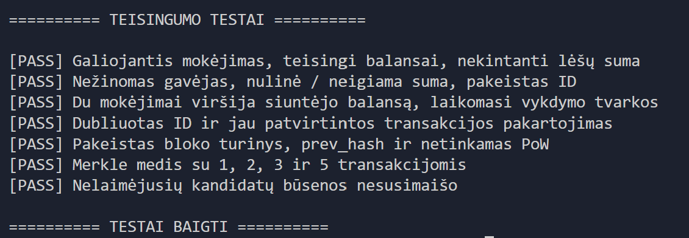

## Kodėl tai nėra tikras P2P konsensusas?

Šiame projekte realizuojama blokų kasimo konkurencijos simuliacija, tačiau ji nėra lygiavertė tikram P2P blokų grandinės konsensusui.

Pagrindiniai skirtumai:

1. **Nėra P2P tinklo.** Programa veikia viename procese, todėl kandidatai nėra atskiri tinklo mazgai, bendraujantys per tinklą.

2. **Nėra nepriklausomų grandinės kopijų.** Visi kandidatai veikia bendroje programos aplinkoje, o ne palaiko atskiras, savarankiškai sinchronizuojamas blokų grandinės kopijas.

3. **Nėra tikro konsensuso protokolo.** Kandidatų rezultatai palyginami programos viduje pagal iš anksto nustatytą taisyklę. Nėra atskiro mazgų susitarimo dėl galiojančios grandinės.

4. **Nerealizuojami šakų persitvarkymai.** Jei skirtingi tinklo mazgai iškastų skirtingus blokus tame pačiame aukštyje, tikrame tinkle galėtų susidaryti skirtingos grandinės šakos. Šiame projekte toks procesas neimituojamas.

5. **Nerealizuojamas tikras Bitcoin kasimas.** Naudojamas supaprastintas Proof of Work mechanizmas, kuriame tikrinamas nustatytas maišos pradžios nulių skaičius. Nenaudojamas tikras Bitcoin tinklo sudėtingumo reguliavimas, atlygis ar kitos protokolo taisyklės.

# Versija: `v0.3`

Dirbtiniu intelektu bandžiau tobulinti transakcijų atrinkimą ir kasimo ciklą, testus.

Nors patobulinus kodą viskas veikia teisingai, sparta kaip tik sumažėjo.

Pavyzdys prieš patobulinimą:


Pavyzdys po patobulinimo:


Svarbu akcentuoti tai, jog SEED naudojimas užtikrina tos pačios skaičių sekos generavimą kiekvieno programos paleidimo metu, tačiau dėl laiko matavimo skirtumo kandidatų kasime kiekvieną kartą paleidus programą su tais pačiais duomenimis, galime gauti skirtingus blokus grandinėse.

### Dirbtinis intelektas (chatGPT, Perplexity, Claude) padėjo:
- Suprasti užduoties reikalavimus, išsiaiškinti principus
- Generuoti abstrakčias idėjas
- Padaryti v0.3 versiją
- Pildyti README failą

# 3 laboratorinis darbas

## Merkle medis su Libbitcoin

| Parametras | Aplinka |
|---|---|
| Biblioteka | libbitcoin-system |
| Versija | 3.8.0 |
| Bibliotekos commit | a012c9b7219fb2b85ecbc981a4982eecdd37263a |
| Šaka | version3 |
| Kompiliatorius | GCC 15.2.0 |
| Build sistema | CMake 4.2.3 |
| Boost	| 1.73.0 |
| Diegimo aplinka | WSL Ubuntu |

Kompiliavimo komanda:

``` cpp
g++ -std=c++20 -I"$HOME/libbitcoin/include" main.cpp $(pkg-config --cflags --libs libbitcoin-system) -o programa
LD_LIBRARY_PATH=/home/usergerda/libbitcoin/lib ./programa
```

Merkle šasknies teisingumo testai:

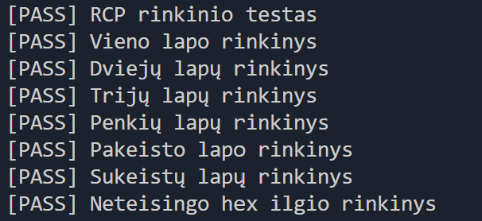

## Bitcoin Core mazgas

Kontrolinė suma sutampa

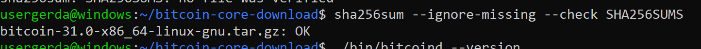

*bitcoind --version* ir *bitcoin-cli --version*:

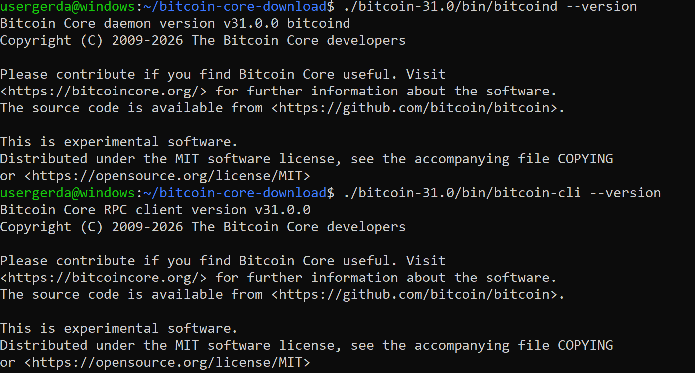

Vietinis regtest mazgas:

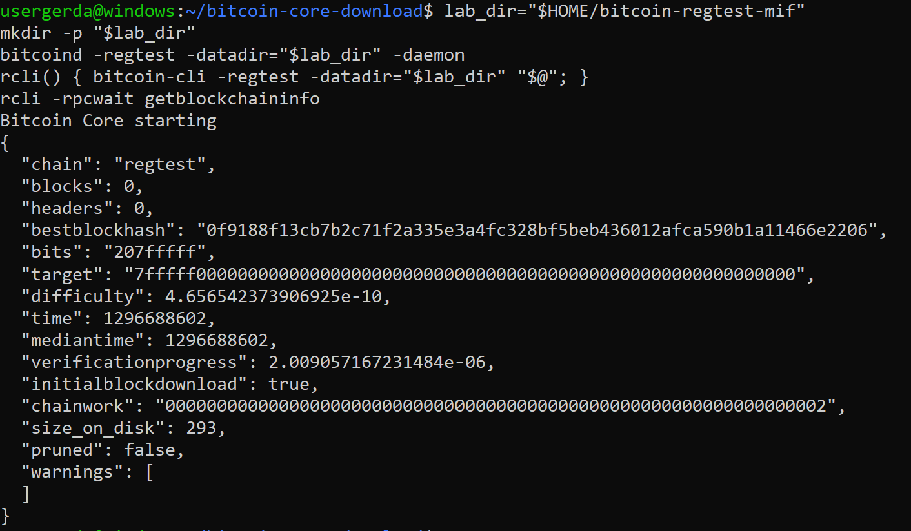

### Paleidimo patikra:

*rcli getblockchaininfo*

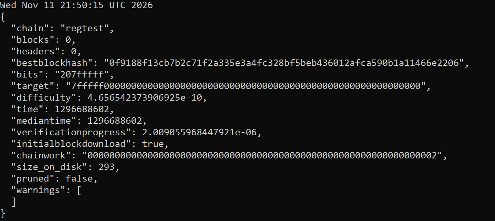

*rcli getnetworkinfo*

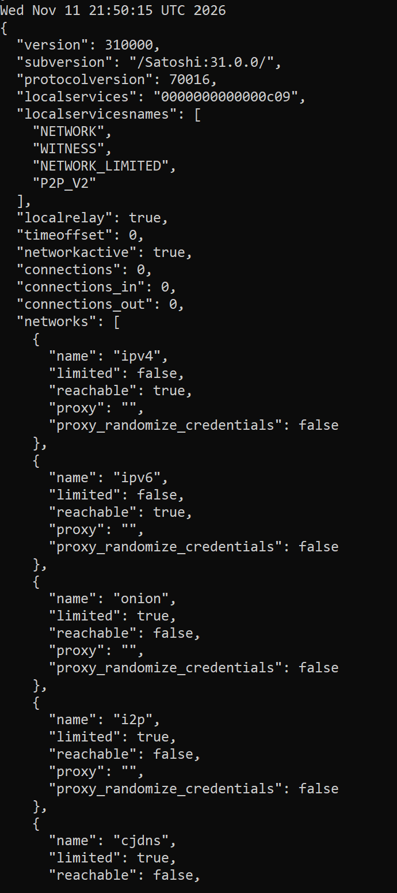

*rcli getconnectioncount*

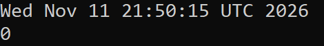

### Piniginės ir subrendęs atlygis:

Įvykdytos komandos:

usergerda@windows:~/bitcoin-core-download$ rcli -named createwallet wallet_name=MIF load_on_startup=true

rcli -named createwallet wallet_name=student load_on_startup=true

miner=$(rcli -rpcwallet=MIF getnewaddress "mining" "bech32")

recipient=$(rcli -rpcwallet=student getnewaddress "payment" "bech32")

rcli generatetoaddress 101 "$miner"

rcli -rpcwallet=MIF getbalances

``` cpp

{
  "name": "MIF"
}
{
  "name": "student"
}
[
  "3c1f7923a9676c5f8eb2aa88b480a3bad89470deec162aaa57031a04fe83a23e",
  "102ba388698dbbe69f71408acd6e33846b946a18193f42343cdab0d285af7537",
  "44401897ecc7f131f84a2fc01140d8f0f1c157bd18ae68241b05419faaad9df5",
  "7c1c6774c6df8d591b0846504fccae0ff8f24e0526ef061ba5d912341500f10a",
  "172e959d68847d8dd7695853b72ae9ce6cc2760949f1e95f82c1505e948173bd",
  "03ae4cf40fd8f042f87929c8b34c38e96a3b64d99d5d8250990c89516cb1db74",
  "0847a1b5a58fe255ec5eee8decac8c7efa05473b8f86b17fd2ef5ea5ff710c00",
  "4fda926667eef7aef206c98b33483dd35f73845398925a3955f1a0328a02ed06",
  "3c7f17232610dabeef845c4636457ac3e7399d967a53879bf9da20e14bcf3b36",
  "3ffc06ab1f6ad5ef0468a84d9f8d625a8e3819dc860880b1ebe50d1b58cb110a",
  "7e8c1e1b7eab6450b0701a5001ba8ca98936a15862d37801dfd8059b1d3b220a",
  "0a8e945207036bda1de81974bdc02a9be905de52b1fdc48b5bb1232fca7dd863",
  "7cc9f2e8eaf6393daf3696e2d3488462ae8bbfba24c50bdd72b19d3cfaf95a28",
  "2b844f01ca18d1992c1c683a8fe7a1b80e4190dae7ec45c80eb6b5c47ad7d107",
  "4af2bcdd5c626603d4002d5c71e3aaa276031df2ee6ddbe11cc07d42ec6a36cf",
  "0ac774d3ac93bfcefb00d8a5e64419b16beb078f13067d335635c2d180eccbe7",
  "71b1a0b698fd4d91f7169cca654b34c8c9f9ea3e97a16ff211b0f5be2edc9324",
  "54d0fc41143900288e6e5fb8da3eace9e6baae2d2e5acaef8e3c8164f792f18e",
  "4608f8f6c9928627a009aea54fe03edbbcd71673eab21555a233cb76a8128334",
  "3b292926b69a8bf898930a8742661473323330f0ebc9d85fe64cd776df040932",
  "6e88f9895f5d80b773318cbbc4b53f1491625b6754fa6393d831e06d59d9d2e6",
  "654193d82d324bea2a811fcc01e6b45aa1ae19bd9a2137cccdbbf289b49d1bb8",
  "6ef299e02aae5df1283bbe90549b55f2341b249cb869d041c1cd80ce21efefac",
  "7f0027e4f5dbde113eb5a4939af2c2e062cee6f1a490d8a7f852d78781fd9313",
  "4daf3a7a266caa27d79da577d515cf457d35c04890a7f09d19e74eea2aaff8ee",
  "7eb84eb5db3c8ca665cfefa1f0282dd7921e8f886243c4589f7ea6d1a0777d47",
  "545ca49fdf6077cc0f0a5496ae158d9f12ace89fcca2c0f963492eed185e4f18",
  "61541186c5d2a4eeaafcbad937ba3c214f7ba287e46031aabea4b9c968d87036",
  "0404a82f947a77bef4fde83b2b3f48babf2b3c7d4b4c169d46193b35962a4e55",
  "3c5a4f450e7687878e2a7e5a9058681b7923f3d959c4bfa1708d6587746ab95e",
  "51ca8bdd0554f59547a3d3b428256b75eedc76c1ab17f600e392e81127194501",
  "27f8eae1b0161f28c2aa4c6db62c387486cfdb64c78f9e44b831bcb005d0135d",
  "1d4538805897534ffe2b9e2e1804bd38ce633d402f9725f15820045d12f3e9f5",
  "755f1949ea0672f0f848097ad1d7f0bb9c3d71ac8f0a0c9b87fae8379b331bd9",
  "5b4360bd1747791df0fbcebf3a36a07a2e5eda8f222896a30cdc8a130e6d00c3",
  "7235b2c47beb44bafce58001896ccb215d800df80b033748e19f4687329a2386",
  "49ae914474db88f5af6394f87c0ff65b9d89aa6351c6407eb61949c115c0833f",
  "1d7587deb7d2a51ef733213878f861b37cbaae54fcea9170d392d37a3eead4e7",
  "2c1e09c35169deaa5fed53924233c483bdd676947f15dabe59c3e2ea425e2c5f",
  "5d2f3d11fe7e841f8895cc853424215bf5e8f5b9c46ebfa4fdc05c9c6dbcd154",
  "6887377bbcd5cb3e905ea3fe3d01754e51b45874816710cf06021bd1baaed623",
  "11d93c89e99e41946a462c9ca68ccc3e1b4c4001aeb08fa96866a90af13f5458",
  "4ad0279fc41f5691575e4ec5af6b72b18c81860449307877b1b148861d970c16",
  "46e4b0d21e3ce728146010ec081e4d9228d2a6a563ee070473efab2f87c42c3a",
  "0b7d33c987935354bc5d91493add17c652ad6af4541a221b42bd04628143cd4e",
  "04d11af68633644bec4fa6f38b44b4e145b4ca269f69311b883441889868c82a",
  "32a5681da67cf60d7f6bbc4018b7941a4354fd938e9d167470b1e014d7145de7",
  "293558f00ab05341d4d5788f003f0ee116aba6ba3c1446680b3a1fff598ce5f1",
  "5012804a41657b02418a362a7782963f035200a45f6b2a2b5ecdcd17b77b2f3b",
  "018ba981f7a8a6ed2c55e09a9405b5ecf5bf29819c6f8e01db91692c001083ef",
  "5e88c688bfefcb005043a1847438d00ee17366daeb03ee764355585d8f1885ed",
  "2d0b1f10bb34e8c8d95355c05a4df12d18d76291b3abbc2a7619decde99dd8bd",
  "343799218c3eabb2b75fd92f6e6e411bf119a00ca616f3fec0c1785e2b146012",
  "56f678bd8ff1a529a9d57dd1e9fb3ee69b7bd82f5afda20aef1bc364d26b6425",
  "32442c79d796f44f51c2fbb1a4d7e51dfdf10409a7339f831fea7608e870329a",
  "2eb44e619f6878d694593b7af7a437ea50020ca323e9a2b535230b245ed6b9f6",
  "2cd52cf8bb7e8c9961ce299a7e0d35c5c26a5fe59a080deeedb6a6ba67159e39",
  "2ae4058ce6d08cae7d0299e851c04cf8c4face78fa4f3376d6edb694aca1e021",
  "4b74349dce4be0c6b1440e1b01d60d999b24c9908e98a2e35aaad47cd5f9b937",
  "541816fbfa9ac8659e3874f038f46c71b8cf851e02d1ed0c2d7719d8a8009686",
  "283ef419b573a33a6820a7b72e06ed892f08d5be4d3de52585017ed3e4c2531b",
  "4c4d12d947c57a69b59a2ab0b4f2309ee409b1edae2f0d4e5d28cfbc2c04fb2c",
  "1aea95ed7b11ffecedf713aa31e3b4f5855a9509aec828eb7810ba1a982b3e5c",
  "594028d28c05ec80724d4e79d5b135e7f2294210fbe01057c6d89a60e2c880c8",
  "7187bc65716d036a945f598a4095473d4652c299451d2f7c3831dd2f7018719f",
  "5afbcd5a7b5201b143b33d389aa0a3fa481725c5f1ed516c8e4f195fd4883865",
  "70e6e2f41375ee7493e5473aea99f1145af3568b673ecdda14e25d3426ba095a",
  "3b5a77ce3a6c1f31d6cf1190bd1fac002ecf53beb01fefdb441335c54f9aea00",
  "5a0235d4db5f29deef99123d10a9bc19363ef4312c425a1b4b3197182ce5aa25",
  "4816fd376f14e9b8120159db4d606e62d517975b0d24548b586fdb330c4e8cd8",
  "473ab4e391da43bc31b671194c685939b4f1f68623508feef2df2ee1621305e6",
  "7e2818ec3045f8097119fd0e8e8008b6fbf1359910c4ac5f3b1373c62c1f1e85",
  "67d53d6a9df8cf9a42922b86248815ad2fab93e1ef2c3577278052ffc7cd7927",
  "0d3629f14d5de2c627a8246aa63ce6e48f058f87358281bc4c4bb3c244265824",
  "1a749a726f7c0e8a4d459444cae1fd07146015379b40201b848ee68910f7a1a7",
  "0e47b606b6343e684cbf6ffd6b51e8a9b5db90c0ab4ee114e1b26d08be9cf0a7",
  "6aa8b654a69fb08d423baba1469043306fd840f04aba7966a77cd00781bbc64d",
  "0e9b046dd2e06cf6715034c6aa5504dc6e663cae07670ef22e1a181448c27d4f",
  "5cae8d1a1e42098acb4145262a89def0dc45462dd64ad73ed1057c7e7f8c8164",
  "265684d3a7a428ba2254bf66e1c9d237461e7dcb2a4d127ea31c1c7898ff0edb",
  "03981edd21a1616e7698377e5834ee10e36fe6b73274d47139bd186ea71ec16a",
  "544d7be1268e1dadb008d65034325f6aed200fb7826e3673c56cc4fc57587606",
  "453a3258bb1bd37c5141539a90d3c1cf21d1537a66366fb495f1c0f53034b060",
  "18f86150424d81ba0f29a3c6818c5ad89c25c812dde7170adb5be0ca9f0ab535",
  "28ed06762f682e7f7925903adf41ffbbd70bbde1a8fb3ddc1ef1f13cd356767f",
  "570a2c538d5a6137cb0892b506d61395be449433efac41af5e18927d90acf158",
  "151c53a30e42fddc12190645f6d004a26feb55c6cfe7f2e89bef73095514f94a",
  "6bf1b54094f19442bdc7523a9805eb3ded9ed6030375a69e7baaabe9dcad6f3c",
  "660dcbb0c3dcbeb576366cec52c3fbab57cadb48a074e8a536232bd3a7a71dec",
  "31ada5e28c081f263f0cad256d313d0031cb322835f38e9d81f3d3aac12fa19a",
  "01817ef4b9aceef89b6fa33c8de2405e45602e265ce91f141df5ec8fbc3c172b",
  "4f2881be4bc9a8a9f45411b09a281b752e7d13f6fbfea4e9151e69c0bcae0576",
  "7981f380797303f587d35ce5643de9151541f33f1bb40dda4cd72dfc84cef5b4",
  "409a5cda8ad98d5ee1b8f0ebcbee8f2f9f830bcd0a8b9a04454f800c261e3d72",
  "1575b2a5c957a8a8a4c4b64c078435d368f252fe99e26ef4ab7e52db56dc063f",
  "7eeeda7f9396b8a53e6db60cc7145be7f4994ed3a0e4c515f95a49f5c6dba2e0",
  "2345f2f32ad73b301e9a7c7c3fef70e012ec3d5a9deab3fd8170a4901c27ee9f",
  "356a62e84ec88cd5efea2f4c16f712e821209bbe2df1173362af893f330514b5",
  "461bd131f9348ea3d23ed59f4ac71b6d6364d0236ea1810ec63cad37f09527de",
  "3231a8e4d71a7d812053de9fa5be0f2d46387f9feef7177f78d7640bd765cd3f",
  "1d81036f30864712f90caf2871eab0901cdac7c4e101375d72a5d17146f94a83"
]
{
  "mine": {
    "trusted": 50.00000000,
    "untrusted_pending": 0.00000000,
    "immature": 5000.00000000
  },
  "lastprocessedblock": {
    "hash": "1d81036f30864712f90caf2871eab0901cdac7c4e101375d72a5d17146f94a83",
    "height": 101
  }
}
```

### Mokėjimas: nuo mempool iki bloko

Būsena PRIEŠ patvirtinimą:


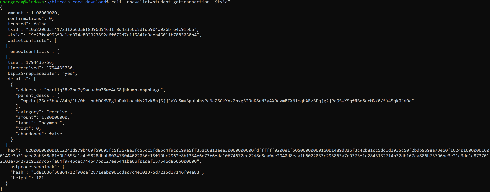

1 naujas blokas:

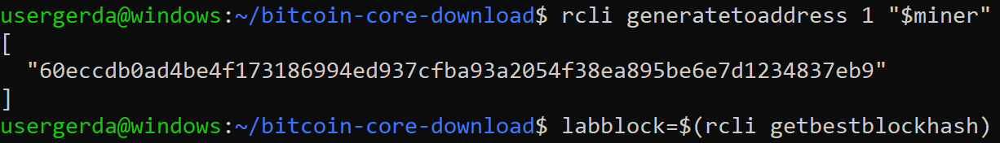

Būsena PO patvirtinimo:

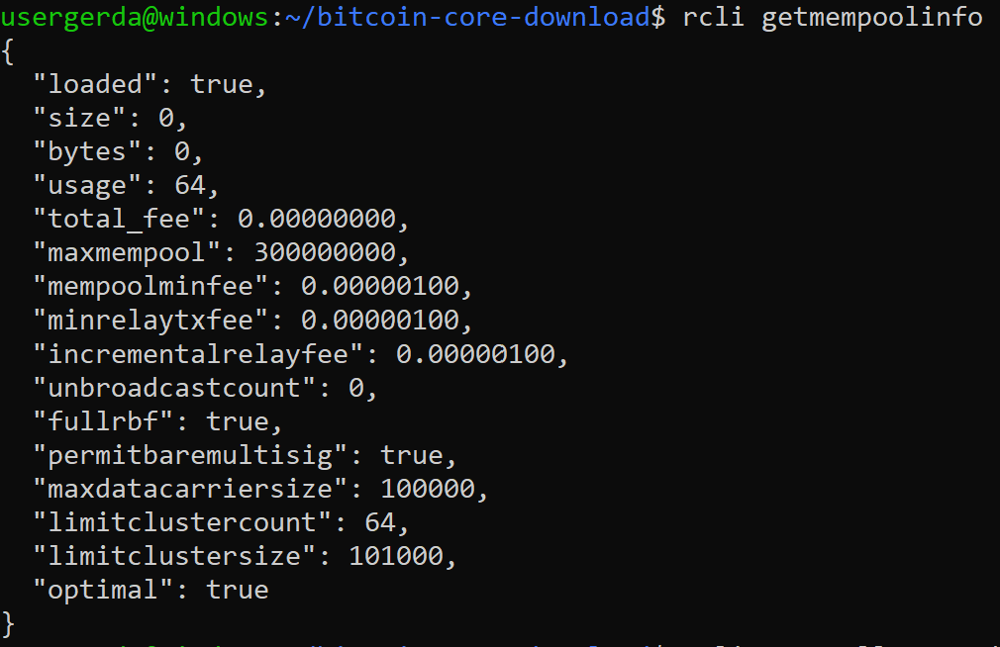

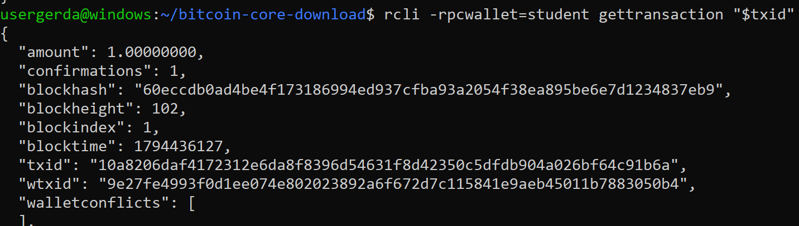

| | Prieš bloką | Po bloko |
|---|---|---|
| Mempool dydis | 1 | 0 |
| Patvirtinimai | 0 | ≥ 1 |
| Vieta | mempool | bloke (`labblock`) |